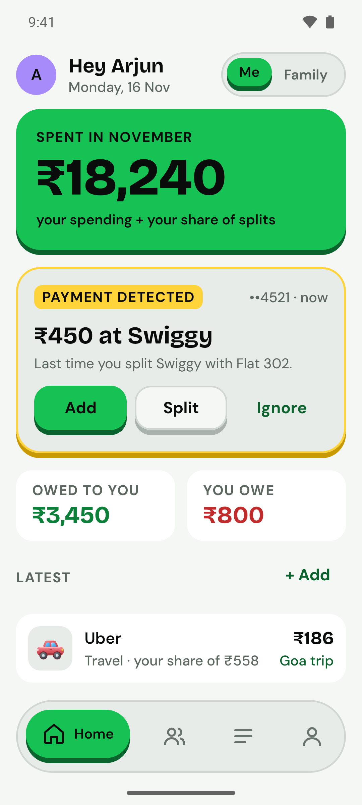
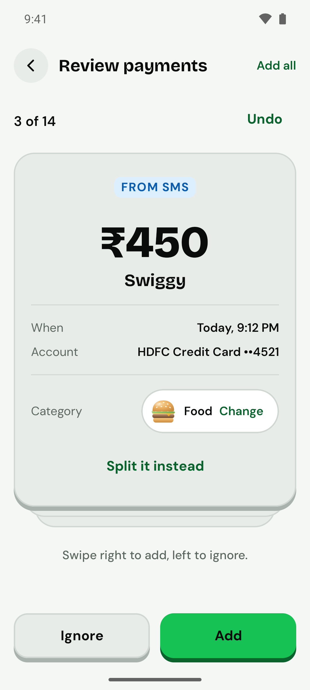
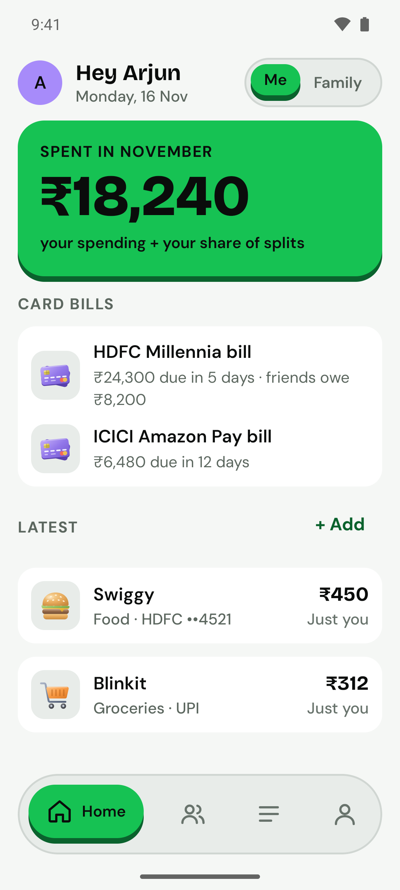
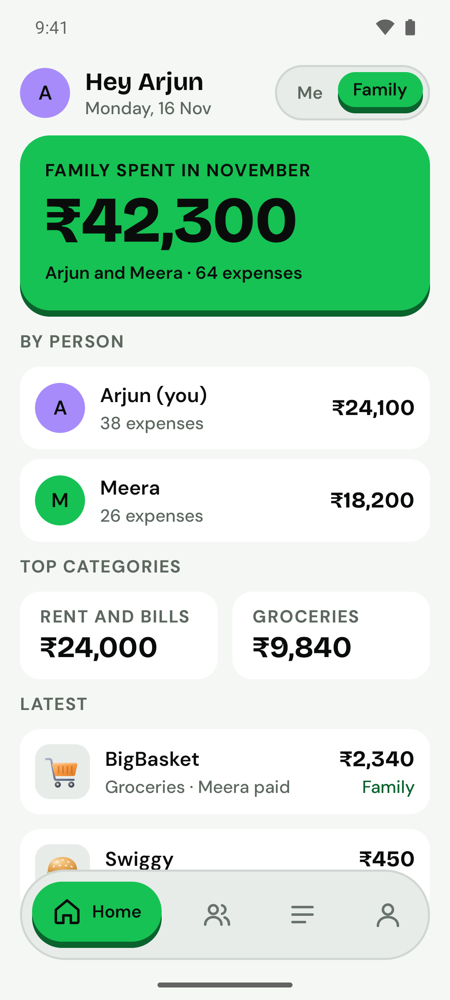
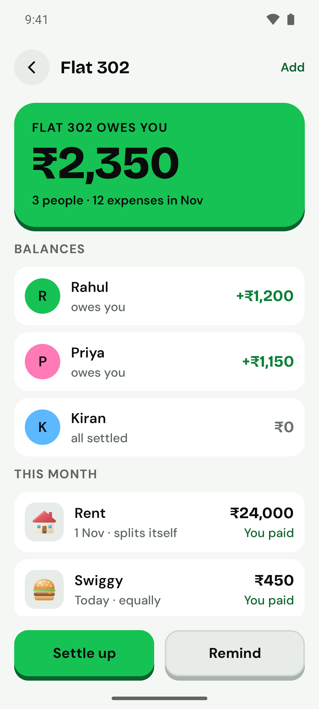
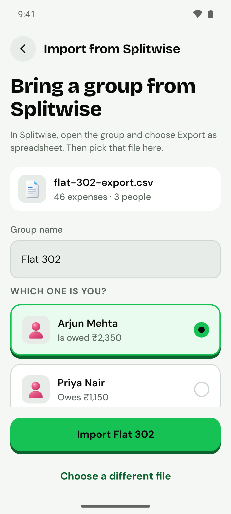

# SumBuddy

SumBuddy adds up your month for you. It reads the bank and UPI SMS already on your Android phone, finds the
payments in them, and asks you to add, split or ignore each one. Your SMS never leave the phone.

- **Your month, without typing.** Spending by category, this month against last month, and card bills: what is due,
  what friends owe you of it, and a reminder 3 days before.
- **Private.** The SMS are read on the phone. No ads and no analytics. Push messages for groups use Google's Firebase
  Cloud Messaging, only after you sign in.
- **Free and open source** (GPL-3.0-or-later). No subscription and no paid features.
- **Split with friends.** Groups, who owes whom, settle up by UPI, cash or bank transfer, and a WhatsApp link for
  friends who don't have the app.
- **Family month.** Share one monthly total with your partner, with no owing between you.
- **Import from Splitwise.** Bring a group across from a Splitwise export file.

Made for India: rupees, Indian banks and UPI. Android 8.0 or later.

## Screenshots

| Home | Review payments | Card bills | A card bill |
|---|---|---|---|
|  |  |  |  |
| **Month** | **Group** | **Family month** | **Import from Splitwise** |
|  |  |  |  |

The screenshots use the app's made-up sample data.

## Download

- **Latest APK:** <https://github.com/akhilux-design/sumbuddy/releases/latest/download/sumbuddy.apk>
- **All releases and notes:** <https://github.com/akhilux-design/sumbuddy/releases>
- **[Obtainium](https://github.com/ImranR98/Obtainium)** (installs and updates apps straight from GitHub): Add App,
  paste `https://github.com/akhilux-design/sumbuddy`, then Add. Each release carries two APKs with the same content
  (`sumbuddy.apk` and `sumbuddy-<version>.apk`); if Obtainium asks, either one is fine.
- **Orion Store:** coming; this list will link it once SumBuddy is listed.
- **F-Droid:** later. F-Droid's main repository does not allow Google Play services or Firebase, which SumBuddy uses
  for sign-in and push, so it needs a separate build without them (`docs/publishing.md`).

SumBuddy is not on Google Play.

### Installing an APK safely

1. Download only from the links above (GitHub, `github.com/akhilux-design/sumbuddy`), or let Obtainium do it.
2. Open the file. Android asks once to let your browser or file manager "install unknown apps": allow it for that one
   app, and turn it off again afterwards if you like (Settings > Apps > Special app access > Install unknown apps).
3. Updates install over the old version only when they are signed with the same key, so a tampered APK cannot
   replace SumBuddy quietly. To check a download yourself, compare its SHA-256 with `SHA256SUMS` on the release page,
   or compare the signing certificate with the fingerprint in [`docs/releasing.md`](docs/releasing.md) (for example
   with the AppVerifier app, or `apksigner verify --print-certs sumbuddy.apk`).
4. Play Protect may warn about an app it has not seen before. That is expected for apps from outside Google Play.

## What it reads, and what never leaves your phone

| | Stays on your phone | Goes to the SumBuddy server |
|---|---|---|
| SMS text and senders | Always. Read on the phone; the app's database keeps the SMS behind each payment and those in Needs review; never in logs, never uploaded. | Never |
| Your own (unsplit) payments, accounts, cards, card bills, notes | Always | Never |
| An expense you split, or mark Family | Yes | Only that expense: description, category, amount, date, who paid and the shares |
| Your name, and the phone number and UPI ID you choose to add | Yes | Yes, after you sign in, to show to people in your groups |
| A Splitwise export file | Read once, never saved | Only the group it holds (names, expenses, amounts, dates), as for any group |

- **Permissions:** read and receive SMS (to find payments; you can say no and add payments by hand), notifications
  (to tell you about a new payment), and internet (only for sign-in, splitting, Family and Import from Splitwise).
  The full list, with the ones the libraries add, is under [Permissions](#permissions).
- **Without signing in** SumBuddy is a tracker that works fully offline, and nothing about you is stored on the
  server.
- **Sign-in is only for splitting, Family and Import from Splitwise**, with your Google account. The server keeps
  your Google account id and name, never your email or picture.
- Backups to Google Drive are switched off, so your data stays in the app on this phone. Uninstalling deletes it.
- You > Account > "Delete account and data" removes your account from the server and the data on this phone.

The full policy is in [PRIVACY.md](PRIVACY.md).

### Permissions

Every permission in the release APK's merged manifest:

| Permission | Added by | Why |
|---|---|---|
| `READ_SMS` | the app | Reads the bank and UPI SMS already on the phone to find payments, on the phone only. Optional: say no and add payments by hand. |
| `RECEIVE_SMS` | the app | Reads a new bank SMS when it arrives, to show "Payment detected". Optional, as above. |
| `POST_NOTIFICATIONS` | the app | Notifications for a payment found and for changes in your groups (asked for on Android 13 and later). |
| `INTERNET` | the app | Only for sign-in, splitting, Family and Import from Splitwise: the SumBuddy server, Google sign-in and push. |
| `ACCESS_NETWORK_STATE` | the app (also WorkManager, Firebase Messaging) | Syncs groups only when there is a network, and shows when you are offline. |
| `WAKE_LOCK` | WorkManager, Firebase Messaging | Keeps the phone awake for the moment background work runs: reading a new SMS, a group sync, a push message. |
| `RECEIVE_BOOT_COMPLETED` | WorkManager | Puts waiting background work (an SMS still to read, the 12-hour group sync) back in the queue after a restart. |
| `FOREGROUND_SERVICE` | WorkManager | On Android 11 and older, urgent background work (reading SMS) runs as a short foreground service with a quiet "reading" notification that shows no message content. |
| `com.google.android.c2dm.permission.RECEIVE` | Firebase Cloud Messaging | Receives push messages ("group X changed") through Google Play services, only after you sign in. |
| `com.akhilux.xpense.DYNAMIC_RECEIVER_NOT_EXPORTED_PERMISSION` | AndroidX Core | The app's own signature permission, which keeps its internal broadcast receivers private on older Android versions. No other app can hold it. |

The Credential Manager library would also add `USE_BIOMETRIC` and `USE_FINGERPRINT` (for passkeys). SumBuddy signs
in with Google only, so `app/src/main/AndroidManifest.xml` removes both.

## How it works

- **On-device parser** (`parser/`, plain Kotlin): turns an SMS into a payment, a card bill, or "not a payment"
  (OTPs, offers, loyalty points). It has no Android or network code and is tested with over a hundred cases of
  made-up SMS from Indian banks, cards, wallets and UPI apps.
- **The app** (`app/`, Kotlin and Jetpack Compose) stores everything in a local database first and works offline.
  Splits wait in an outbox and sync when there is a network.
- **The server** (`server/`) is a Cloudflare Worker with a D1 database and one Durable Object per group for live
  updates. It holds only what is shared: groups, members, split expenses and settlements. Balances are worked out the
  same way on the phone and the server (`splits/` and `server/test/vectors/`).
- **Push** uses Firebase Cloud Messaging with data-only messages ("group X changed"): the phone syncs and writes the
  notification itself, so no expense passes through Google.
- **The friends' page** (`server/web/`) is the link a friend without the app opens from WhatsApp: their share, the
  expenses behind it, and Pay by UPI. No sign-in and no third-party requests.

## Build from source

You need JDK 21 and the Android SDK (compile SDK 37). Set `JAVA_HOME` and `ANDROID_HOME` (or `local.properties`),
then from the repository root:

```bash
./gradlew :app:assembleDebug          # app/build/outputs/apk/debug/app-debug.apk
./gradlew :app:installDebug           # onto a connected phone or emulator
```

What a self-built app can do:

- **Tracking works fully**: SMS reading, Home, Review payments, Month, card bills and Activity need no server.
- **A self-built app has no push, and cannot sign in to the public server.** Google sign-in works only for an app
  signed with the maintainer's key, and the app's Firebase values (needed for push) are not in this repository.
  Without push the app still syncs when it is opened, over the live connection while it is open, and every 12 hours.
- A **debug** build has its own app id (`com.akhilux.xpense.debug`, version name ending in `-debug`), so it installs
  next to the public app and can never replace it. It talks to a server on your computer (below) and offers "Dev
  sign-in" there, so you can try splitting end to end without any Google set-up.
- A **release** build (`./gradlew :app:assembleRelease`) builds from a clean clone: `gradle.properties` holds the
  public server's address, its Google web client id and the link host, none of them secret. To point it at your own
  server, override them in `~/.gradle/gradle.properties` (see [`docs/server-setup.md`](docs/server-setup.md)).
  Without the maintainer's keystore it comes out unsigned.

### Tests

```bash
./gradlew :parser:test :splits:test :splitwise:test :app:testDebugUnitTest
(cd server && npm ci && npm test)
(cd server/web && npm ci && npm test)
```

### Run the server locally

```bash
cd server
npm ci
cp .dev.vars.example .dev.vars        # a local secret only
npm run db:migrate:local
npm run dev                           # http://127.0.0.1:8787
```

The Android emulator reaches it at `http://10.0.2.2:8787`, which is where debug builds look. To put your own server
online on free Cloudflare and Google accounts, follow [`docs/server-setup.md`](docs/server-setup.md).

## Repository map

| Path | What it is |
|---|---|
| `app/` | The Android app (package `com.expenses.app`) |
| `parser/` | SMS to payments, pure Kotlin, no Android dependencies |
| `splits/` | Split rounding and balances, pure Kotlin; same answers as the server |
| `splitwise/` | Reads a Splitwise export (CSV) on the phone |
| `server/` | Cloudflare Worker: sign-in, groups, sync, push |
| `server/web/` | The friends' link page (Cloudflare Pages) |
| `design/spec/` | Exported copy of the Figma design: tokens, components, every screen in dark and light, the flow |
| `design/icons/` | SVG sources of the icons |
| `docs/product.md` | Product decisions and version 1 scope |
| `docs/architecture.md`, `docs/server.md` | How the app is built; the server contract |
| `docs/server-setup.md` | Run your own server |
| `docs/releasing.md`, `docs/publishing.md` | How releases are made and where they are listed |
| `fastlane/metadata/` | Store listing text and images (the layout F-Droid and other stores read) |

The design is the source of truth for the screens. `design/spec` is the exported copy of the maintainer's Figma file,
which is private (the Figma link in `docs/product.md` opens only for the maintainer); the export holds everything
needed to build the screens.

## Contributing

Bug reports and ideas are welcome: see [CONTRIBUTING.md](CONTRIBUTING.md). Please never paste real SMS, account
numbers or UPI IDs into an issue. Security problems go privately: [SECURITY.md](SECURITY.md).

## Contact

akhilu.design@gmail.com, for questions, privacy requests (also from people who are not on GitHub) and anything that
should not be in a public issue.

## How this was made

akhilux designed SumBuddy in Figma: what it does, its flows and how every screen looks (`design/spec` is an export of
that file). It was developed by akhilux with Claude Code, an AI coding tool from Anthropic, which wrote most of the
code, tests and documentation. Changes are checked by the automated tests in this repository, by separate AI review
passes, and on an Android emulator against the design. Commits written with Claude carry a "Co-Authored-By: Claude"
line.

## Licence

Copyright (C) 2026 akhilux

SumBuddy is free software: you can redistribute it and/or modify it under the terms of the GNU General Public License
as published by the Free Software Foundation, either version 3 of the License, or (at your option) any later version.

SumBuddy is distributed in the hope that it will be useful, but WITHOUT ANY WARRANTY; without even the implied
warranty of MERCHANTABILITY or FITNESS FOR A PARTICULAR PURPOSE. See the GNU General Public License for more details.
The full text is in [LICENSE](LICENSE). SPDX identifier: `GPL-3.0-or-later`.

**Additional permission under GNU GPL version 3 section 7:** If you modify this Program, or any covered work, by
linking or combining it with the Google Play services client libraries, Firebase Cloud Messaging, the Google Identity
Services library (googleid) or the Credential Manager Play services module (or modified versions of those libraries),
containing parts covered by the terms of the Android Software Development Kit License, the licensors of this Program
grant you additional permission to convey the resulting work.

Fonts, icons and other parts that come from others keep their own licences: see
[THIRD_PARTY_NOTICES.md](THIRD_PARTY_NOTICES.md).

SumBuddy is an independent project. It is not affiliated with or endorsed by Splitwise, Google, NPCI or any bank;
their names are used only to say what SumBuddy works with.
